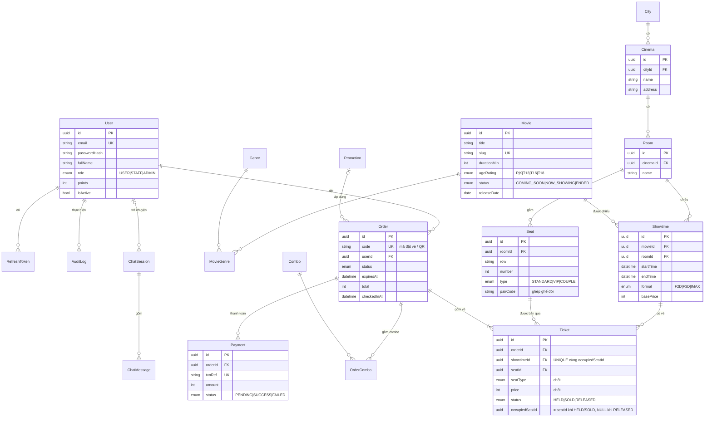

# 03 — Thiết kế cơ sở dữ liệu

> Phiên bản: **1.3 — cập nhật 21/11/2026: bỏ bảng `SeatLock`; `Ticket` trở thành lớp trung gian Suất chiếu – Ghế (thêm `showtimeId`, `status`, `occupiedSeatId`); bỏ `Order.showtimeId`** (theo nhận xét GVHD 18/11: quan hệ sai hướng đối tượng, SeatLock không liên quan vé — xem mục 1.0). API không đổi. Trước đó 1.2 — 14/11/2026: đổi tên bảng `OrderSeat` → `Ticket` (và quan hệ `Order.seats` → `tickets`, `Seat.orderSeats` → `tickets`); dữ liệu và API giữ nguyên (API vẫn trả `seats`). Trước đó 1.1 — 02/10/2026 (thêm bảng chuẩn bị AI). Schema đầy đủ: [`schema.prisma`](./schema.prisma).
> CSDL: PostgreSQL · ORM: Prisma · Quy ước: tên bảng/cột tiếng Anh, `camelCase`; tiền là số nguyên VND; thời gian lưu UTC.

## 1. Quyết định thiết kế quan trọng

### 1.0 Vì sao đổi ở v1.3 (nhận xét GVHD 18/11/2026)

| Trước (v1.2) | Vấn đề theo hướng đối tượng | Sau (v1.3) |
|---|---|---|
| `Ticket` chỉ nối `Order`, `Seat` (không biết thuộc suất nào) | Bỏ sót quan hệ **nhiều – nhiều Suất chiếu – Ghế** (một suất nhiều ghế, một ghế có ở nhiều suất) — loại quan hệ phải tách bằng **lớp trung gian** | `Ticket` = lớp trung gian: nối `Showtime`, `Seat`, thuộc một `Order` |
| `SeatLock(showtime, seat, order)` song song với `Ticket` | **Hai lớp cùng một vai trò** ("ghế G5 suất 19:45 thuộc đơn X") mà không liên quan nhau | Bỏ `SeatLock`; trạng thái giữ / bán nằm ngay trên vé (`Ticket.status`) |
| `Order.showtime` | Liên kết **thừa, tạo vòng** (Order → SeatLock → Showtime → Order) và có thể mâu thuẫn | Bỏ; suất của đơn lấy qua vé (`order.tickets[*].showtime`, mọi vé của một đơn cùng một suất) |

### 1.1 Ghế thuộc về đâu?

| Khái niệm | Thuộc về | Bảng |
|---|---|---|
| Ghế **vật lý** (G7, loại VIP) — tồn tại mãi | Phòng chiếu | `Seat` |
| **Vé**: một ghế trong một suất, kèm giá chốt và trạng thái (đang giữ / đã bán / đã nhả) | Tổ hợp (Suất chiếu, Ghế), thuộc một Đơn | `Ticket` |

- ❌ Sai phổ biến: thêm cột `status` vào `Seat` → G7 bán ở suất 18h thì bị "bán" luôn ở mọi suất.
- ✅ Trạng thái ghế của một suất suy ra từ **các vé còn hiệu lực** của suất đó. **Không có vé còn hiệu lực = ghế trống.**

### 1.2 Vé: trạng thái và trọng tài chống trùng ghế

| `Ticket.status` | `occupiedSeatId` | Ý nghĩa | Khi nào |
|---|---|---|---|
| `HELD` | = `seatId` | Đang giữ — có hiệu lực khi `Order.expiresAt > now` | Giữ ghế (BR-01) |
| `SOLD` | = `seatId` | Đã bán | **Chỉ** IPN hợp lệ (mục 5.7) |
| `RELEASED` | `NULL` | Đã nhả — vé vẫn còn làm lịch sử (BR-14, BR-31) | Hủy đơn, đơn hết hạn, lệch tiền / mất ghế khi IPN |

- ⭐ **Trọng tài**: `UNIQUE (showtimeId, occupiedSeatId)`. PostgreSQL coi các giá trị `NULL` là **khác nhau**, nên vé đã nhả (NULL) không chặn ai; còn mỗi (suất, ghế) chỉ có **tối đa một vé** đang giữ hoặc đã bán. Hai giao dịch cùng chèn vé cho một ghế → một bên nhận lỗi `P2002`.
- `occupiedSeatId` là **cột kỹ thuật** của tầng CSDL (không có trong biểu đồ lớp thực thể): nó luôn bằng `seatId` khi vé `HELD`/`SOLD` và `NULL` khi `RELEASED`. **Chỉ `ticket.dao.js` ghi cột này**, luôn cùng câu lệnh với `status`.
- Vì sao không dùng *partial unique index* (`UNIQUE … WHERE status IN ('HELD','SOLD')`)? Prisma 6 chưa khai báo được loại index này trong `schema.prisma`; tự thêm bằng SQL thì các lần `prisma migrate dev` sau có thể đề xuất xóa / tạo lại nó. Cột `occupiedSeatId` cho cùng hiệu quả mà khai báo được hoàn toàn trong schema.
- Hạn giữ ghế **chỉ lưu ở `Order.expiresAt`** (không chép sang vé).

Suy ra trạng thái ghế của một suất:

| Vé của (suất, ghế) | Trạng thái hiển thị |
|---|---|
| Không có vé `HELD`/`SOLD`, hoặc vé `HELD` mà đơn đã quá hạn | Trống |
| Vé `HELD`, đơn còn hạn | Đang giữ |
| Vé `SOLD` | Đã bán |

### 1.3 Phi chuẩn hóa có chủ đích

| Chỗ | Lý do |
|---|---|
| `Ticket.price`, `Ticket.seatType`, `Ticket.seatLabel`, `OrderCombo.unitPrice` | Đóng băng giá / nhãn ghế lúc mua (BR-14) |
| `Ticket.occupiedSeatId` | Cột kỹ thuật cho ràng buộc chống trùng ghế (mục 1.2) |
| `Order.total`, `Order.discount`… | Số tiền đã gửi sang VNPay phải cố định để đối soát; báo cáo nhanh |
| `Showtime.basePrice` | Giá gốc chốt khi tạo suất (tra từ `PriceRule`); admin có thể điều chỉnh riêng một suất |
| `Promotion.usedCount` | Kiểm tra "còn lượt" nhanh, cập nhật nguyên tử khi thanh toán thành công |

## 2. Danh sách bảng (22 bảng)

| Nhóm | Bảng | Mô tả | Ưu tiên |
|---|---|---|---|
| Tài khoản | `User` | Tài khoản, vai trò USER / STAFF / ADMIN, điểm | M |
| | `RefreshToken` | Refresh token (lưu dạng băm) để đăng xuất / thu hồi | M |
| | `AuditLog` | Nhật ký thao tác quản trị / soát vé: ai làm gì, lúc nào (FR-39) | S |
| Phim | `Movie` | Thông tin phim, trạng thái chiếu, phân loại độ tuổi | M |
| | `Genre` | Thể loại | M |
| | `MovieGenre` | Bảng trung gian N–N phim ↔ thể loại | M |
| Rạp | `City` | Thành phố | M |
| | `Cinema` | Cụm rạp | M |
| | `Room` | Phòng chiếu | M |
| | `Seat` | Ghế vật lý (hàng, số, loại, cặp ghế đôi) | M |
| Lịch chiếu & giá | `Showtime` | Suất chiếu: phim + phòng + giờ + định dạng + giá gốc | M |
| | `PriceRule` | Giá gốc theo (định dạng × loại ngày) — BR-12 | M |
| | `SeatTypeSurcharge` | Phụ thu theo loại ghế — BR-13 | M |
| Đặt vé | `Order` | Đơn hàng: trạng thái, hạn giữ, tổng tiền, mã đặt vé / QR, check-in | M |
| | `Ticket` | Vé = một ghế trong một suất, thuộc một đơn: giá chốt + trạng thái HELD / SOLD / RELEASED — **UNIQUE chống trùng** | M ⭐ |
| | `OrderCombo` | Combo của đơn + đơn giá chốt | S |
| | `Payment` | Từng lần thanh toán VNPay của đơn (có thể thử lại nhiều lần) | M ⭐ |
| Marketing | `Combo` | Danh mục combo | S |
| | `Promotion` | Mã khuyến mãi | S |
| | `Banner` | Banner trang chủ | C |
| AI Agent | `ChatSession` | Cuộc hội thoại + bản nháp đặt vé (`state` JSON) — tạo sẵn, dùng ở giai đoạn AI | Giai đoạn AI |
| | `ChatMessage` | Từng tin nhắn / lần gọi tool trong hội thoại | Giai đoạn AI |

> Bổ sung ở Giai đoạn 5 để chuẩn bị cho AI: `Movie.searchKey` (tìm không dấu), `Order.source` (WEB / AI_CHAT), hai bảng chat. Chi tiết: `07-ai-hooks.md`.

## 3. ERD



## 4. Giải thích từng bảng

| Bảng | Cột đáng chú ý | Ràng buộc / index |
|---|---|---|
| `User` | `passwordHash` (bcrypt), `role`, `points` | UNIQUE `email` |
| `RefreshToken` | `tokenHash`, `expiresAt`, `revokedAt` | index `userId` |
| `AuditLog` | `actorId`, `action` (mẫu route), `entityType`, `entityId`, `details` (JSON an toàn) | index `createdAt`, `actorId`, (`entityType`,`entityId`). **Chỉ thêm, không sửa / xóa** |
| `Movie` | `slug` (dùng cho URL đẹp), `ageRating`, `status`, `posterUrl`, `trailerUrl` | UNIQUE `slug`; index `status` |
| `MovieGenre` | `movieId`, `genreId` | PK kép (movieId, genreId) |
| `Cinema` | `cityId`, `address` | index `cityId` |
| `Seat` | `row` ("G"), `number` (7), `type`, `pairCode` (2 ghế đôi cùng mã), `isActive` (ghế hỏng) | UNIQUE (roomId, row, number) |
| `Showtime` | `startTime`, `endTime` (= start + thời lượng + dọn phòng), `format`, `basePrice`, `status` | index (movieId, startTime), (roomId, startTime). Chặn trùng giờ trong cùng phòng: kiểm tra ở service |
| `PriceRule` | `format`, `dayType` (WEEKDAY / WEEKEND), `basePrice` | UNIQUE (format, dayType) |
| `SeatTypeSurcharge` | `seatType`, `surcharge` | PK `seatType` |
| `Order` | `code` (chuỗi ngẫu nhiên — BR-32), `status`, `expiresAt`, `seatTotal`, `comboTotal`, `discount`, `total`, `promotionId`, `paidAt`, `checkedInAt`, `checkedInById` | UNIQUE `code`; index (userId, createdAt), (status, expiresAt) cho tác vụ dọn dẹp |
| `Ticket` ⭐ | `showtimeId`, `seatId`, `seatLabel`, `seatType`, `price` (bản chốt; ghế đôi: **mỗi ghế lưu một nửa giá cặp** để `seatTotal` = tổng `price`), `status`, `occupiedSeatId` | UNIQUE (orderId, seatId); **UNIQUE (showtimeId, occupiedSeatId)**; index `seatId` |
| `OrderCombo` | `quantity`, `unitPrice` (chốt) | UNIQUE (orderId, comboId) |
| `Payment` | `txnRef` (mã giao dịch gửi VNPay), `amount`, `status`, `providerTxnNo`, `rawData` (JSON để đối soát) | UNIQUE `txnRef`; index `orderId` |
| `Promotion` | `code`, `discountType` (PERCENT / FIXED), `discountValue`, `maxDiscount`, `minOrderValue`, `startAt`, `endAt`, `usageLimit`, `usedCount` | UNIQUE `code` |
| `Combo` | `name`, `price`, `imageUrl`, `isActive` | — |
| `Banner` | `imageUrl`, `linkUrl`, `sortOrder`, `startAt`, `endAt` | — |

> Quy ước "mỗi tài khoản chỉ dùng 1 mã 1 lần" (BR-22) kiểm tra bằng truy vấn `Order` có `promotionId` + `userId` + `status = PAID`; an toàn vì mỗi tài khoản chỉ có 1 đơn PENDING (BR-03).

## 5. Cơ chế giữ ghế & chống trùng ghế ⭐ (cốt lõi đề tài)

### 5.1 Nguyên lý

- **Không** "đọc xem ghế trống rồi mới ghi" (check-then-act → race condition).
- **Ghi thẳng** các dòng `Ticket` (HELD); ràng buộc **UNIQUE (showtimeId, occupiedSeatId)** của PostgreSQL là **trọng tài duy nhất**: hai giao dịch cùng ghi một ghế → đúng một giao dịch thành công, giao dịch kia nhận lỗi vi phạm UNIQUE (PostgreSQL `23505`, Prisma `P2002`).
- Mọi thao tác nhiều bước nằm trong **một transaction** → hoặc tất cả thành công, hoặc không có gì thay đổi.
- Mức cô lập mặc định `READ COMMITTED` là đủ, vì sự đúng đắn dựa vào UNIQUE chứ không dựa vào việc đọc.

### 5.2 Giữ ghế — `holdSeats(userId, showtimeId, seatIds)`

**Kiểm tra trước (không cần transaction):**
1. Suất chiếu tồn tại, đang mở bán, còn > 15 phút trước giờ chiếu (BR-04).
2. 1 ≤ số ghế ≤ 8 (BR-02); ghế thuộc đúng phòng của suất; ghế `isActive`.
3. Ghế đôi đủ cặp theo `pairCode` (BR-05).
4. Tính giá từng ghế ở server: `Showtime.basePrice` + `SeatTypeSurcharge` (BR-11, BR-15).

**Trong một transaction:**

| # | Thao tác | Mục đích |
|---|---|---|
| 1 | Đơn PENDING cũ của user → `CANCELLED`; nhả vé của đơn đó (`HELD` → `RELEASED`) | BR-03 |
| 2 | Nhả các vé **HELD của đơn đã quá hạn** trên chính các ghế được yêu cầu trong suất này | Dọn "lười" (lazy) — không chờ tác vụ định kỳ |
| 3 | Tạo `Order` (PENDING, `expiresAt` = now + 10 phút, tổng tiền) | BR-01 |
| 4 | Chèn **tất cả** `Ticket` của đơn trong **một câu lệnh** (HELD, `occupiedSeatId = seatId`, giá chốt) | Trọng tài UNIQUE, BR-14 |
| 5 | COMMIT | |

- Bước 4 vi phạm UNIQUE → **ROLLBACK toàn bộ** (không ghế nào bị giữ, không đơn nào được tạo) → truy vấn lại các ghế đang bị chiếm → trả `409 SEAT_UNAVAILABLE` kèm danh sách ghế.
- ⚠️ **Không** dùng `createMany({ skipDuplicates: true })` cho bước 4 (chèn `Ticket`): nó **lặng lẽ bỏ qua** ghế trùng → đơn 3 ghế mà chỉ khóa được 2 → bán trùng.

### 5.3 Hai người cùng giữ G7

```mermaid
sequenceDiagram
    participant A as Request của A
    participant DB as PostgreSQL
    participant B as Request của B
    A->>DB: BEGIN; INSERT Ticket(suất 1, G7, HELD)
    B->>DB: BEGIN; INSERT Ticket(suất 1, G7, HELD)
    Note over DB: B phải CHỜ vì A đang ghi cùng khóa UNIQUE
    A->>DB: COMMIT
    DB-->>A: ✅ Thành công
    DB-->>B: ❌ Vi phạm UNIQUE (23505)
    B->>DB: ROLLBACK
    Note over B: Trả 409 SEAT_UNAVAILABLE
```

Dù hai request đến cách nhau 1 mili-giây, PostgreSQL xếp chúng thành hàng; người đến sau luôn thất bại sạch sẽ.

### 5.4 Đọc sơ đồ ghế

`Seat` của phòng + các `Ticket` còn hiệu lực (`occupiedSeatId` khác NULL) của suất kèm `Order.expiresAt`, rồi suy trạng thái theo bảng ở mục 1.2 (vé HELD của đơn đã quá hạn được coi là **trống** ngay cả khi chưa được nhả).

### 5.5 Các thao tác khác trên đơn PENDING

Chọn combo, áp mã, tạo thanh toán, hủy đơn: luôn kiểm tra `status = PENDING` **và** `expiresAt > now`; sai → `ORDER_EXPIRED`. Hủy đơn (BR-07): đơn → `CANCELLED` + nhả vé của đơn (`HELD` → `RELEASED`), trong một transaction.

### 5.6 Tác vụ dọn dẹp định kỳ (mỗi 1 phút)

1. Tìm đơn `PENDING` có `expiresAt < now` (dùng index `(status, expiresAt)`).
2. Với mỗi đơn, trong transaction: cập nhật **có điều kiện** `status = EXPIRED WHERE status = PENDING` (an toàn nếu IPN vừa xác nhận đơn cùng lúc) → nhả các vé `HELD` của đơn.

> Tác vụ này chỉ để **dữ liệu sạch**. Nếu nó ngừng chạy, hệ thống vẫn **đúng** nhờ mục 5.2 bước 2 và mục 5.4. Chạy bằng `node-cron` trong tiến trình server.

### 5.7 Xác nhận thanh toán (IPN) — `confirmPayment(ipnData)`

1. Kiểm chữ ký → sai: từ chối (E6).
2. Tìm `Payment` theo `txnRef` → không có: từ chối. So khớp số tiền → lệch: từ chối.
3. `Payment` đã `SUCCESS` → trả "đã xác nhận", không làm gì (idempotent — E7).
4. VNPay báo thất bại → `Payment` = `FAILED`; đơn giữ nguyên (E5).
5. VNPay báo thành công → **Transaction xác nhận**:
   - Tổng đơn khác số tiền đã thu → nhả vé, đơn `REFUND_PENDING` (khách đổi combo / mã sau khi tạo link).
   - Nhả các vé HELD của **đơn khác đã quá hạn** trên các ghế của đơn.
   - Với từng `Ticket` của đơn: đặt `status = SOLD`, `occupiedSeatId = seatId`. Vé đang `HELD` → chỉ đổi trạng thái; vé đã `RELEASED` (đơn từng hết hạn) → chiếm lại ghế, nếu ghế đã thuộc vé khác thì UNIQUE báo `P2002`.
   - `Order` → `PAID`, `paidAt`; `Payment` → `SUCCESS`; `Promotion.usedCount + 1` (BR-24); cộng điểm (BR-25).
6. Nếu bước 5 vi phạm UNIQUE (`P2002`) (ghế đã bị người khác lấy — chỉ xảy ra khi IPN đến muộn) → ROLLBACK → transaction khác: `Payment` = `SUCCESS`, `Order` = `REFUND_PENDING` (BR-31, E8).

> Một thuật toán duy nhất xử lý được cả IPN đúng hạn lẫn đến muộn.

### 5.8 Vì sao chọn cách này? (chuẩn bị câu hỏi hội đồng)

| Phương án | Ưu | Nhược | Kết luận |
|---|---|---|---|
| **INSERT vé + UNIQUE** (đã chọn) | Đơn giản, DB đảm bảo tuyệt đối, không cần tạo trước dữ liệu | Phải bắt lỗi UNIQUE | ✅ |
| `SELECT … FOR UPDATE` (khóa bi quan) | Quen thuộc | Cần sẵn một dòng cho mỗi (suất, ghế) để khóa; dễ deadlock khi giữ nhiều ghế | ❌ |
| Cột `version` (khóa lạc quan) | Không chặn nhau | Vẫn cần dòng có sẵn; phải tự thử lại | ❌ |
| Redis lock | Rất nhanh, có TTL tự hết hạn | Thêm hạ tầng; hai nguồn sự thật (Redis và DB) dễ lệch | Để dành giai đoạn AI / mở rộng |

## 6. Schema Prisma

File đầy đủ: [`schema.prisma`](./schema.prisma) — 22 model, 16 enum (v1.3: bỏ `SeatLock`/`LockStatus`, thêm `TicketStatus`). Khi bắt đầu code, chép vào `server/prisma/schema.prisma`.

### 6.1 Index và lý do

| Index | Phục vụ truy vấn |
|---|---|
| `Movie (status, releaseDate)` | Danh sách phim đang chiếu / sắp chiếu |
| `Showtime (movieId, startTime)` | Lịch chiếu theo phim và ngày (truy vấn nhiều nhất của khách) |
| `Showtime (roomId, startTime)` | Kiểm tra trùng giờ khi admin tạo suất; lịch chiếu theo rạp |
| `Order (userId, createdAt)` | "Vé của tôi" sắp xếp mới nhất |
| `Order (status, expiresAt)` | Tác vụ dọn đơn hết hạn mỗi phút |
| `Order (promotionId, userId)` | Kiểm tra mỗi tài khoản dùng mã 1 lần (BR-22) |
| `Ticket` UNIQUE `(showtimeId, occupiedSeatId)` | ⭐ Chống trùng ghế + đọc sơ đồ ghế của một suất (cột đầu là `showtimeId`) |
| `Ticket` UNIQUE `(orderId, seatId)` | Nhả / chốt toàn bộ vé của một đơn |
| `Payment.txnRef` UNIQUE | Tìm giao dịch khi nhận IPN |

> Nguyên tắc: chỉ thêm index cho truy vấn thật sự hay dùng — mỗi index làm thao tác ghi chậm đi một chút.

### 6.2 Hành vi khi xóa (onDelete)

| Quan hệ | Hành vi | Lý do |
|---|---|---|
| `Ticket`, `OrderCombo` → `Order` | Cascade | Là "con" của đơn; không tồn tại độc lập |
| `RefreshToken` → `User`, `MovieGenre` → `Movie`/`Genre` | Cascade | Dữ liệu phụ trợ |
| `AuditLog` → `User` | SetNull | Giữ nhật ký ngay cả khi tài khoản người thực hiện bị xóa |
| Các quan hệ còn lại (Movie, Showtime, Seat, User → Order…) | Restrict (mặc định) | **Không cho xóa** dữ liệu đã có lịch sử giao dịch → admin dùng `isActive` / `status` để ẩn thay vì xóa |

### 6.3 Những gì Prisma không biểu diễn được (làm ở service hoặc migration SQL)

| Ràng buộc | Cách làm |
|---|---|
| Suất chiếu không trùng giờ trong cùng phòng | Kiểm tra ở service khi tạo / sửa suất (nâng cao: exclusion constraint của PostgreSQL) |
| `quantity > 0`, `total >= 0`, `discountValue` hợp lệ | Validate ở service; tùy chọn thêm `CHECK` trong file migration SQL |
| Ghế đôi đủ cặp, tối đa 8 ghế | Service `holdSeats` (BR-02, BR-05) |
| Mọi vé của một đơn cùng một suất | `order.service.holdSeats` tạo tất cả vé với cùng `showtimeId` (đơn không có cột suất riêng) |
| `occupiedSeatId` = `seatId` ⇔ vé HELD/SOLD | Chỉ `ticket.dao.js` ghi; test kiểm tra (mục 1.2) |
| Giá gốc theo loại ngày | Service tra `PriceRule` khi tạo suất (T6–CN = WEEKEND) |

### 6.4 Dữ liệu mẫu (seed) cần có

(cập nhật 26/11/2026) 3 thành phố · 9 cụm rạp · 12 phòng / rạp (sơ đồ 8 hàng × 12 ghế, có hàng VIP và hàng ghế đôi) · ~23 phim thật từ TMDB · suất chiếu 14 ngày tới, mỗi phòng chiếu nối tiếp từ 08:00 đến suất mở cuối không quá 23:30, phim chia theo độ phổ biến trong từng thành phố (3 phim đầu trọng số 8, 4 phim kế 3, còn lại 1; ngày nào phim nào cũng có suất) · bảng `PriceRule` + `SeatTypeSurcharge` theo BR-12, BR-13 · 4–5 combo · 3 mã khuyến mãi · tài khoản mẫu cho USER / STAFF / ADMIN.

## 7. Lịch sử thay đổi

| Ngày | Phiên bản | Thay đổi |
|---|---|---|
| 02/10/2026 | 1.1 | Thêm bảng chuẩn bị AI (`ChatSession`, `ChatMessage`), `Movie.searchKey`, `Order.source` |
| 14/11/2026 | 1.2 | Đổi tên `OrderSeat` → `Ticket` |
| 21/11/2026 | 1.3 | Theo nhận xét GVHD (18/11): bỏ `SeatLock`, `LockStatus`; `Ticket` thêm `showtimeId`, `status` (`TicketStatus`: HELD/SOLD/RELEASED), `occupiedSeatId`, `createdAt`, ràng buộc UNIQUE (showtimeId, occupiedSeatId); bỏ `Order.showtimeId`. Viết lại mục 1, 5. API không đổi |
