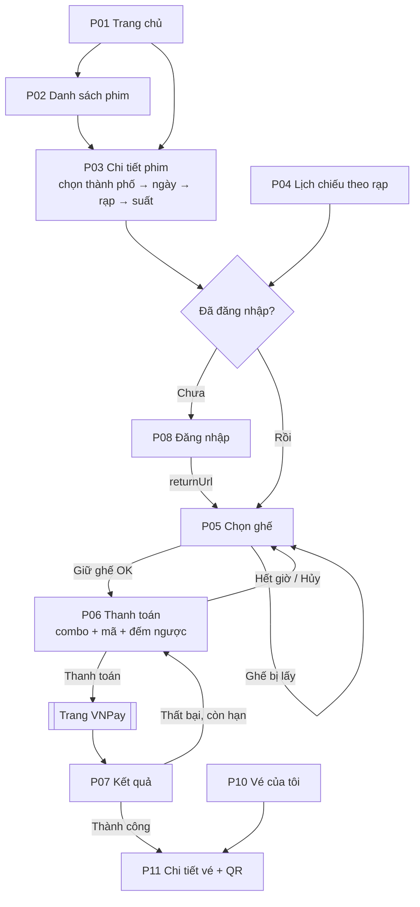

# 05 — Thiết kế giao diện (Trang & luồng điều hướng)

> Phiên bản: 1.0 — chốt ngày 02/10/2026. Thương hiệu: **Cinemind** (không dùng nhận diện CGV).
> Ưu tiên theo `01-requirements.md`: M = MVP, S = nên có, C = có thì tốt.
> v1.1 (26/11/2026): thanh menu mới + trang P14 Thành viên; P03 xem trailer ngay trong trang; chân trang ghi nguồn dữ liệu phim TMDB.

## 1. Danh sách trang

### 1.1 Khách hàng (Guest + Thành viên)

| Mã | Trang | Đường dẫn | Quyền | Ưu tiên | FR |
|---|---|---|---|---|---|
| P01 | Trang chủ | `/` | Công khai | M | FR-01, FR-06 |
| P02 | Danh sách phim | `/movies?status=now\|soon&q=&genre=` | Công khai | M | FR-01, FR-04 |
| P03 | Chi tiết phim + chọn suất | `/movies/:slug` | Công khai | M | FR-02, FR-03 |
| P04 | Danh sách rạp / lịch chiếu theo rạp | `/cinemas?city=`, `/cinemas/:id` | Công khai | S | FR-05 |
| P05 | **Chọn ghế** ⭐ | `/booking/showtimes/:showtimeId` | USER | M | FR-11 |
| P06 | **Thanh toán** (combo + mã + tổng) ⭐ | `/booking/orders/:orderId` | USER (chủ đơn) | M | FR-12→14 |
| P07 | Kết quả thanh toán | `/payment/result` | USER | M | FR-14 |
| P08 | Đăng nhập | `/login?returnUrl=` | Công khai | M | FR-10 |
| P09 | Đăng ký | `/register` | Công khai | M | FR-10 |
| P10 | Vé của tôi | `/me/tickets` | USER | M | FR-15 |
| P11 | Chi tiết vé + QR | `/me/tickets/:code` | USER (chủ đơn) | M | FR-15 |
| P12 | Hồ sơ cá nhân | `/me/profile` | USER | S | FR-16 |
| P13 | Không tìm thấy / Không có quyền | `*`, `/403` | Công khai | M | — |
| P14 | Thành viên (điểm và cách tích điểm) | `/members` | Công khai | C | FR-17 |
| P15 | Xác minh email (nhập mã 6 số) | `/verify-email?returnUrl=` | USER | S | FR-18a |
| P16 | Quên mật khẩu (xin mã → đặt mật khẩu mới) | `/forgot-password` | Công khai | S | FR-18b |

### 1.2 Nhân viên

| Mã | Trang | Đường dẫn | Quyền | Ưu tiên |
|---|---|---|---|---|
| S01 | Soát vé | `/staff/check-in` | STAFF, ADMIN | S |

### 1.3 Quản trị (layout riêng: sidebar trái + nội dung)

| Mã | Trang | Đường dẫn | Ưu tiên |
|---|---|---|---|
| A01 | Tổng quan / báo cáo doanh thu | `/admin` | S |
| A02 | Phim (danh sách + form) | `/admin/movies` | M |
| A03 | Suất chiếu: lịch timeline theo rạp + ngày, danh sách (lọc rạp, ngày), tạo hàng loạt | `/admin/showtimes` | M |
| A04 | Rạp, phòng (thêm / sửa / ngưng / xóa), xem sơ đồ ghế | `/admin/cinemas` | S |
| A05 | Bảng giá | `/admin/pricing` | M |
| A06 | Đơn hàng (lọc theo trạng thái, xử lý REFUND_PENDING) | `/admin/orders` | M |
| A07 | Combo | `/admin/combos` | S |
| A08 | Khuyến mãi | `/admin/promotions` | S |
| A09 | Tài khoản & phân quyền | `/admin/users` | S |
| A10 | Banner | `/admin/banners` | C |
| A11 | Nhật ký thao tác (ai làm gì, lúc nào) | `/admin/audit` | S |

**A03 Suất chiếu (v1.1, FR-31a/b):** hai chế độ xem.
- **Lịch theo phòng** (mặc định): chọn rạp và ngày; mỗi phòng một hàng, mỗi suất một khối dài theo thời lượng (phần sọc cuối khối là 15 phút dọn phòng), mỗi phim một màu (tối đa 16 màu, cấp cho phim nhiều suất trước; phim còn lại nền trắng), khối có số ghế đã đặt. Bấm chỗ trống (hoặc nút "+" ở đầu hàng) mở form thêm suất điền sẵn phòng và giờ; bấm khối mở form sửa, có nút hủy suất. Trục giờ bắt đầu 08:00, cuộn ngang được.
- **Danh sách:** bảng như trước.
- **Giờ kết thúc:** khối trên lịch, bản xem trước hàng loạt, danh sách và form ghi "bắt đầu–giờ phim kết thúc"; giờ dọn xong ghi riêng. Form thêm / sửa một suất hiện ngay giờ phim kết thúc, giờ phòng trống lại, các suất phòng đã có trong ngày và cảnh báo nếu giờ chọn bị đè; server vẫn là nơi quyết định cuối cùng.
- **Tạo hàng loạt:** chọn phim, phòng, từ ngày – đến ngày, các giờ; bấm "Xem trước" để thấy suất nào tạo được, suất nào trùng, rồi mới "Tạo N suất". Đổi bất kỳ ô nào thì phải xem trước lại.

**A04 Rạp & phòng (v1.1, FR-32a):** mỗi thẻ rạp có nút "+ Phòng" (nhập tên, chọn mẫu sơ đồ nhỏ / vừa / lớn). Chọn một phòng để xem sơ đồ ghế, kèm các nút "Đổi tên", "Ngưng phòng" / "Mở lại", "Xóa phòng". Ngưng và xóa phải xác nhận; server từ chối thì hiện lý do. Phòng đã ngưng có nhãn "Ngưng".

> **Mẹo tiết kiệm công:** A02, A07, A08, A09, A10 dùng chung một khuôn "bảng danh sách + bộ lọc + form trong modal". Làm kỹ một lần (A02), các trang còn lại sao chép và đổi cột.

## 2. Luồng điều hướng



**Quy tắc điều hướng:**
- Route cần đăng nhập bọc bởi `RequireAuth`; route theo vai trò bọc bởi `RequireRole(['ADMIN'])`… Chưa đăng nhập → chuyển `/login?returnUrl=<trang hiện tại>` → đăng nhập xong quay lại đúng chỗ.
- Luồng đặt vé tối đa **4 màn hình** (P03 → P05 → P06 → P07).
- Trang trí chủ đề điện ảnh (v1.1): dải "phim nhựa" đỏ có lỗ răng ở mép trên và dưới header, logo cuộn phim, nút vé "Mua vé ngay" (màn rộng ≥ 1024px, dẫn tới phim đang chiếu). Nhận diện riêng, không sao chép rạp khác. Khi cuộn trang, hàng tìm kiếm / tài khoản trôi đi, thanh menu ở lại.
- Header (v1.1) hai hàng: hàng trên gồm ô tìm kiếm và Đăng nhập **hoặc** menu tài khoản (Vé của tôi, Hồ sơ, [Soát vé], [Quản trị], Đăng xuất) tùy vai trò; hàng dưới là logo, thanh menu giữa hai đường kẻ: Phim, Rạp Cinemind, Thành viên. Đã đăng nhập thì có thêm **"Vé của tôi"** ở bên phải thanh menu (và trong menu ☰); màn hình "Đặt vé thành công" (P07) có hai nút "Xem vé" và "Vé của tôi". Rê chuột (hoặc Tab) vào mỗi mục hiện menu con nền tối; bấm vào mục cha vẫn mở trang của nó. **Phim:** Phim đang chiếu, Phim sắp chiếu (P02 `?status=now|soon`). **Rạp Cinemind:** Tất cả các rạp, rồi mỗi thành phố một mục (P04 `?city=<id>`, mã lạ thì hiện tất cả). **Thành viên:** Tài khoản Cinemind (P12, khách được đưa tới đăng nhập), Quyền lợi (P14). Màn hình hẹp gộp thanh menu vào nút ☰. ("Quầy dịch vụ online" và trang Khuyến mãi chưa làm.)
- **P15:** sau khi đăng ký được đưa tới đây; ô nhập 6 số, nút "Gửi lại mã" (đếm ngược 60 giây), nút "Để sau". Tài khoản chưa xác minh thấy dải nhắc ở đầu mọi trang khách; giữ ghế bị `EMAIL_NOT_VERIFIED` thì chuyển tới P15 rồi quay lại đúng suất.
- **P16:** liên kết "Quên mật khẩu?" ở P08. Bước 1 nhập email (luôn báo "nếu email đã đăng ký thì mã đã được gửi"); bước 2 nhập mã + mật khẩu mới; xong về đăng nhập.
- **P14:** khách chưa đăng nhập thấy cách tích điểm và nút Đăng ký / Đăng nhập; đã đăng nhập thấy điểm hiện có (lấy mới từ `GET /auth/me`), liên kết Vé của tôi và Hồ sơ. Chỉ nêu quyền lợi hệ thống thật sự có: tích 1 điểm / 10.000đ đã thanh toán (BR-25), **chưa đổi điểm**, chưa có hạng thành viên.

## 3. Wireframe các trang chính

### P01 — Trang chủ
```
┌──────────────────────────────────────────────────────────┐
│ CINEMIND Phim  Rạp  Khuyến mãi   [🔍 Tìm phim...]  [Đăng nhập]│
├──────────────────────────────────────────────────────────┤
│  ◀        BANNER TRƯỢT (khuyến mãi / phim hot)        ▶   │
├──────────────────────────────────────────────────────────┤
│  [ Đang chiếu ]  [ Sắp chiếu ]                  Xem tất cả →│
│  ┌────┐ ┌────┐ ┌────┐ ┌────┐ ┌────┐                        │
│  │post│ │post│ │post│ │post│ │post│   ← poster + T13 badge │
│  └────┘ └────┘ └────┘ └────┘ └────┘                        │
│  Tên phim  Tên phim  ...   [Mua vé]                          │
├──────────────────────────────────────────────────────────┤
│  Khuyến mãi nổi bật: ▢ ▢ ▢                                 │
│  Footer: giới thiệu, liên hệ, điều khoản                   │
└──────────────────────────────────────────────────────────┘
```

### P03 — Chi tiết phim + chọn suất
```
┌──────────────────────────────────────────────────────────┐
│ ┌──────┐  TÊN PHIM                         [T16]          │
│ │poster│  Thể loại · 120 phút · Khởi chiếu 03/10          │
│ │      │  Đạo diễn / Diễn viên / Mô tả...                 │
│ └──────┘  [▶ Xem trailer]                                 │
├──────────────────────────────────────────────────────────┤
│ Thành phố: [Hà Nội ▾]                                     │
│ Ngày: [T6 02/10] [T7 03/10] [CN 04/10] ... (7 ngày)        │
│ ── Rạp A ────────────────────────────────────────         │
│    2D Phụ đề:   [09:30] [13:15] [19:45]                    │
│    3D Lồng tiếng: [16:00]                                  │
│ ── Rạp B ────────────────────────────────────────         │
│    2D Phụ đề:   [10:00] [20:30]                            │
└──────────────────────────────────────────────────────────┘
  (Suất còn < 15 phút trước giờ chiếu: ẩn hoặc làm mờ — BR-04)
```

**Thẻ phim ở P01 / P02 (v1.1):** thiết bị có chuột, rê vào poster hiện nút phát trailer ở giữa, tên phim, "Xem chi tiết" và "Mua vé" (phim sắp chiếu không có "Mua vé"); dùng bàn phím cũng hiện. Thiết bị cảm ứng: nút phát nằm trên poster, hai nút nằm dưới tên phim.

**Trailer (v1.1, 26/11/2026):** link YouTube phát ngay trong hộp thoại trên trang (nhúng `youtube-nocookie.com`, chỉ tải khi bấm, đóng hộp thoại thì video dừng); link nguồn khác mở tab mới.

### P05 — Chọn ghế ⭐
```
┌──────────────────────────────────────────────────────────┐
│ Tên phim · Rạp A · Phòng 3 · 19:45 T6 02/10 · 2D Phụ đề    │
├──────────────────────────────────────────────────────────┤
│                    ═════ MÀN HÌNH ═════                    │
│   A  ▢ ▢ ▢ ▢ ▢ ▢ ▢ ▢ ▢ ▢ ▢ ▢                              │
│   ...                                                     │
│   F  ◆ ◆ ◆ ■ ■ ◆ ◆ ◆ ◆ ◆ ◆ ◆   ← hàng VIP                  │
│   G  ◆ ◆ ◆ ◆ ◆ ◆ ✔ ◆ ◆ ◆ ◆ ◆                              │
│   H  [▭▭] [▭▭] [▭▭] [▭▭] [▭▭]   ← ghế đôi                  │
│                                                           │
│ Chú thích: ▢ Thường ◆ VIP [▭▭] Đôi ✔ Đang chọn            │
│            ▒ Đang giữ  ■ Đã bán                           │
├──────────────────────────────────────────────────────────┤
│ Ghế: G7 (VIP)                      Tạm tính: 105.000đ      │
│ [← Quay lại]                              [Tiếp tục →]     │
└──────────────────────────────────────────────────────────┘
```
- Sơ đồ tự làm mới mỗi 10–15 giây (NFR-12); trên điện thoại cuộn ngang.
- Bấm ghế đôi chọn cả cặp; chặn chọn quá 8 ghế ngay trên giao diện (server vẫn kiểm tra lại).
- Lỗi `SEAT_UNAVAILABLE`: thông báo nổi, tải lại sơ đồ, **giữ nguyên** các ghế còn hợp lệ, bỏ chọn ghế bị mất.

### P06 — Thanh toán ⭐
```
┌──────────────────────────────────────────────────────────┐
│ ⏱ Thời gian giữ ghế còn lại: 08:42                        │
├───────────────────────────────┬──────────────────────────┤
│ COMBO BẮP NƯỚC                │ TÓM TẮT ĐƠN               │
│ ▢ Combo 1 Bắp + 1 Nước 69.000 │ Tên phim · 19:45 02/10    │
│   [-] 1 [+]                   │ Rạp A · Phòng 3           │
│ ▢ Combo Đôi         109.000   │ Ghế: G7 (VIP)  105.000    │
│   [-] 0 [+]                   │ Combo:          69.000    │
│                               │ Giảm giá:      -20.000    │
│ MÃ KHUYẾN MÃI                 │ ──────────────────────    │
│ [ NHAPMA      ] [Áp dụng]     │ TỔNG:          154.000đ   │
│ ✔ Đã áp dụng: giảm 20.000     │                           │
│                               │ [Hủy đơn]  [Thanh toán →] │
└───────────────────────────────┴──────────────────────────┘
```
- Mọi con số do **server** trả về sau mỗi thay đổi; client không tự tính.
- Đồng hồ hết giờ → hộp thoại "Đã hết thời gian giữ ghế" → về P05.

### P07 — Kết quả thanh toán
```
   ⏳ Đang xác nhận thanh toán...   (hỏi server mỗi 2 giây, tối đa 30 giây)
   ✅ Đặt vé thành công!  [Xem vé]          ← đơn PAID
   ❌ Thanh toán chưa thành công. [Thử lại] ← đơn còn PENDING, còn hạn
   ⚠️ Đơn đã hết hạn giữ ghế ...            ← EXPIRED / REFUND_PENDING (kèm hướng dẫn liên hệ)
```
> Trang này chỉ **đọc** trạng thái đơn từ server — không tự kết luận dựa vào tham số trên URL (nguyên tắc IPN).

### P11 — Chi tiết vé
```
┌──────────────────────────────┐
│        ┌──────────┐          │
│        │ QR CODE  │          │
│        └──────────┘          │
│     Mã đặt vé: K7Q2-M9XA     │
│  Tên phim [T16]              │
│  Rạp A · Phòng 3             │
│  19:45 T6 02/10/2026         │
│  Ghế: G7, G8                 │
│  Combo: 1 × Combo 1          │
│  Tổng: 154.000đ · Đã thanh toán│
│  Trạng thái: Chưa sử dụng    │
└──────────────────────────────┘
```

### S01 — Soát vé
```
┌──────────────────────────────────────────┐
│ Mã đặt vé: [ K7Q2-M9XA ] [Tra cứu]        │
├──────────────────────────────────────────┤
│ ✅ HỢP LỆ                                 │
│ Tên phim [T16] · Phòng 3 · 19:45          │
│ Ghế: G7, G8 · Khách: Nguyễn Văn A         │
│              [ CHECK-IN ]                 │
├──────────────────────────────────────────┤
│ ❌ Vé đã sử dụng lúc 19:32 / Sai suất /   │
│    Chưa tới giờ / Suất đã qua (BR-34)     │
└──────────────────────────────────────────┘
```

### Khuôn trang quản trị (A02, A07–A10)
```
┌──────────┬───────────────────────────────────────────────┐
│ Tổng quan│ Phim                           [+ Thêm phim]  │
│ Phim     │ [🔍 Tìm...] [Trạng thái ▾]                     │
│ Suất chiếu│ ┌──────┬──────────┬──────┬────────┬────────┐  │
│ Rạp      │ │Poster│ Tên      │ Thời lượng│Trạng thái│ ⋯  │ │
│ Bảng giá │ ├──────┼──────────┼──────┼────────┼────────┤  │
│ Đơn hàng │ │ ...  │ ...      │ ...  │ ...    │Sửa/Ẩn │  │
│ Combo    │ └──────┴──────────┴──────┴────────┴────────┘  │
│ Khuyến mãi│               « 1 2 3 »                       │
│ Tài khoản│  (Form thêm / sửa mở trong modal)              │
└──────────┴───────────────────────────────────────────────┘
```

## 4. Quy ước giao diện chung

| Hạng mục | Quy ước |
|---|---|
| Trạng thái dữ liệu | Mỗi trang có đủ 3 trạng thái: **đang tải** (skeleton), **rỗng**, **lỗi** (kèm nút thử lại) |
| Thông báo | Toast cho thành công / lỗi ngắn; hộp thoại cho lỗi chặn luồng (hết giờ giữ ghế) |
| Tiền, giờ | Định dạng `154.000đ`; giờ Việt Nam `19:45 T6 02/10/2026` |
| Responsive | Tối thiểu 360 px; sơ đồ ghế cuộn ngang trên điện thoại (NFR-16) |
| Màu trạng thái ghế | Thống nhất một bộ màu cho Thường / VIP / Đôi / Đang chọn / Đang giữ / Đã bán, kèm chú thích |
| Dữ liệu từ server | Dùng TanStack Query; dữ liệu giả (mock) theo đúng `04-api-contract.md` khi backend chưa xong |
