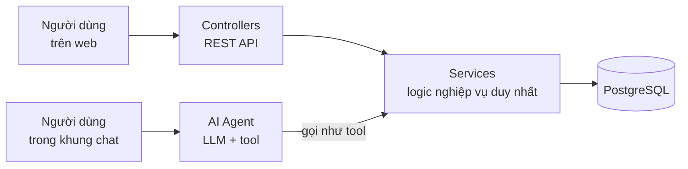
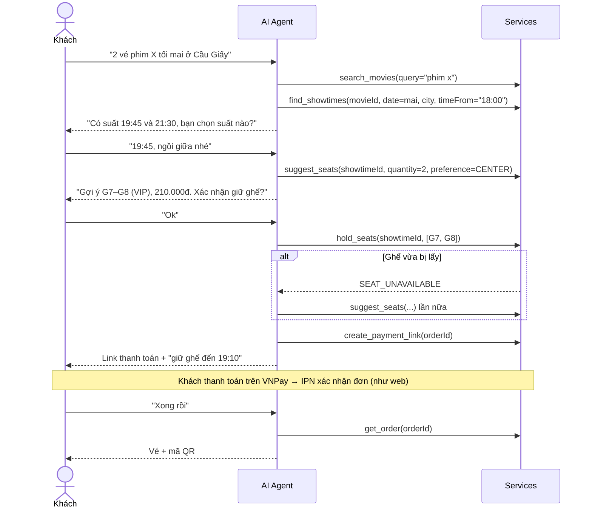
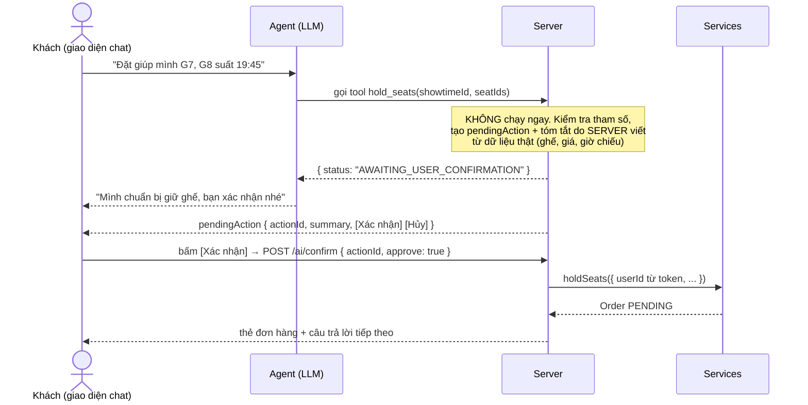

# 07 — Chuẩn bị tích hợp AI Agent

> Phiên bản: 2.0 — cập nhật 29/10/2026 (mục 7–11: quyết định và kế hoạch giai đoạn AI) · bản gốc 1.0 chốt 02/10/2026 · Hệ thống: **Cinemind**
> Mục đích: thiết kế hệ thống đặt vé sao cho giai đoạn AI (tháng 11) chỉ cần **thêm** một lớp mới, không phải sửa lại lõi.

## 1. Ý tưởng chính



- AI Agent là **một "kênh" mới**, ngang hàng với controller. Nó **không** có logic nghiệp vụ riêng.
- Mọi luật (giữ ghế 10 phút, tối đa 8 ghế, chống trùng ghế, tính giá…) tự động áp dụng cho cả web lẫn chat vì cùng đi qua service.
- Thư mục dự kiến: `server/src/ai/` gồm `tools.js` (khai báo tool → service), `agent.js` (vòng lặp gọi LLM), `chat.routes.js`.

## 2. Danh sách tool (ánh xạ sang service)

**Quy ước:** `userId` **luôn do server lấy từ phiên đăng nhập** và truyền vào service — **không bao giờ** để LLM tự điền.

### 2.1 Tool chỉ đọc (gọi tự do)

| Tool | Service | Tham số | Kết quả trả về (rút gọn) |
|---|---|---|---|
| `search_movies` | `catalogService.searchMovies` | `query?` (tên, không cần dấu), `status?`, `genre?` | `[{ id, title, ageRating, durationMin, genres, status }]` |
| `get_movie_details` | `catalogService.getMovie` | `movieId` | Thông tin phim đầy đủ |
| `list_cinemas` | `catalogService.listCinemas` | `city?` (tên, không cần dấu) | `[{ id, name, address, city }]` |
| `find_showtimes` | `showtimeService.findShowtimes` | `movieId`, `date` (`YYYY-MM-DD`), `city?` / `cinemaId?`, `timeFrom?`, `timeTo?` (`HH:mm`), `format?` | `[{ showtimeId, cinemaName, startTimeLocal, format, audio, availableSeatCount, basePrice }]` — danh sách **phẳng** để LLM dễ đọc |
| `get_seat_map` | `showtimeService.getSeatMap` | `showtimeId` | Như `GET /showtimes/:id/seats` + tóm tắt `{ available, byType }` |
| `suggest_seats` | `showtimeService.suggestSeats` *(viết ở giai đoạn AI)* | `showtimeId`, `quantity`, `preference?` (`CENTER` \| `BACK` \| `AISLE`), `seatType?` | `[{ seatIds, labels, totalPrice }]` — tối đa 3 phương án ghế liền nhau |
| `list_combos` | `catalogService.listCombos` | — | `[{ id, name, price }]` |
| `get_order` | `bookingService.getOrder` | `orderId` | `Order` (cấu trúc chung) |
| `list_my_tickets` | `bookingService.listMyOrders` | `status?` | `OrderSummary[]` |

### 2.2 Tool thay đổi dữ liệu (bắt buộc người dùng xác nhận trước — **do server cưỡng chế**, xem mục 8)

| Tool | Service | Tham số | Kết quả | Lỗi có thể gặp |
|---|---|---|---|---|
| `hold_seats` | `bookingService.holdSeats` | `showtimeId`, `seatIds` | `Order` PENDING + `expiresAt` | `SEAT_UNAVAILABLE`, `SEAT_LIMIT_EXCEEDED`, `COUPLE_SEAT_INCOMPLETE`, `SHOWTIME_CLOSED` |
| `set_combos` | `bookingService.setCombos` | `orderId`, `items: [{ comboId, quantity }]` | `Order` | `ORDER_EXPIRED` |
| `apply_promotion` | `bookingService.applyPromotion` | `orderId`, `code` | `Order` | `PROMO_INVALID` |
| `create_payment_link` | `paymentService.createPayment` | `orderId` | `{ paymentUrl, expiresAt }` | `ORDER_EXPIRED` |
| `cancel_order` | `bookingService.cancelOrder` | `orderId` | `Order` CANCELLED | `ORDER_NOT_PENDING` |

### 2.3 **Không** cấp cho AI

`confirmPayment` (chỉ IPN được gọi), check-in, mọi service quản trị, đổi vai trò / tài khoản.

## 3. Luồng mẫu: đặt vé qua hội thoại



## 4. Lưu ngữ cảnh hội thoại & "phiên đặt vé nháp"

| Giai đoạn hội thoại | Lưu ở đâu | Ghi chú |
|---|---|---|
| Đang hỏi đáp, chưa chọn ghế | `ChatSession.state` (JSON) | Ví dụ `{ "movieId": "...", "city": "Hà Nội", "date": "2026-11-05", "quantity": 2, "seatPreference": "CENTER" }`. Chưa giữ gì nên không cần bảng riêng |
| Đã giữ ghế | `Order` PENDING (bảng có sẵn) + `state.currentOrderId` | Bản nháp **chính là đơn PENDING** — đã có hạn 10 phút, đã có giá chốt, đã chống trùng ghế |
| Lịch sử tin nhắn + lần gọi tool | `ChatMessage` | Gửi lại N tin gần nhất cho LLM làm ngữ cảnh; dùng để debug và viết báo cáo |

> **Vì sao không tạo bảng `BookingDraft` riêng?** Trước khi giữ ghế, "bản nháp" chỉ là thông tin hội thoại → để trong `state`. Sau khi giữ ghế, `Order` PENDING đã đóng đúng vai bản nháp. Thêm bảng thứ ba sẽ tạo hai nguồn sự thật cho cùng một đơn.

## 5. Nguyên tắc an toàn

| Nguyên tắc | Cách làm |
|---|---|
| AI không tự quyết thay người dùng | Tool ở mục 2.2 chỉ gọi sau khi khách **xác nhận rõ ràng** trong hội thoại |
| AI không cầm tiền | Thanh toán luôn qua link VNPay do khách tự bấm; đơn chỉ thành PAID qua IPN |
| Không tin tham số từ LLM | `userId` lấy từ phiên; service vẫn kiểm tra mọi luật như với web; kiểm tra quyền sở hữu `orderId` |
| Dữ liệu là dữ liệu | Mô tả phim, tên khuyến mãi… đưa cho LLM dưới dạng dữ liệu, không phải chỉ dẫn (chống *prompt injection* — chèn lệnh qua nội dung) |
| Giới hạn chi phí | Giới hạn số tin nhắn / phút cho mỗi phiên; cắt ngắn lịch sử gửi cho LLM |
| Lỗi dễ hiểu | Tool trả lại đúng `code` + `message` tiếng Việt từ `AppError` → AI diễn đạt lại cho khách |

## 6. Việc cần làm **ngay từ bây giờ** (trong 4 sprint đặt vé)

| # | Việc | Sprint | Vì sao giúp AI |
|---|---|---|---|
| 1 | Service nhận **một object tham số** có tên rõ ràng, ví dụ `holdSeats({ userId, showtimeId, seatIds })` | 1–3 | Ánh xạ 1-1 sang tham số tool |
| 2 | Service trả **object thuần**, cùng cấu trúc với API (`Order` chung) | 1–3 | AI và web đọc cùng một dạng dữ liệu |
| 3 | Lỗi luôn là `AppError(code, message tiếng Việt)` | 1 | AI đọc `code` để xử lý tiếp, đọc `message` để nói với khách |
| 4 | Viết **JSDoc** ngắn cho mỗi hàm service public (mô tả, tham số, lỗi) | 1–3 | Chuyển gần như nguyên văn thành mô tả tool |
| 5 | `Movie.searchKey` (tên không dấu, chữ thường) do service tự điền khi tạo / sửa phim; `searchMovies` tìm theo nó | 1 | Khách gõ / nói "nha ba nu" vẫn ra "Nhà Bà Nữ" — web cũng hưởng lợi (FR-04) |
| 6 | `findShowtimes` hỗ trợ `timeFrom` / `timeTo` và trả `availableSeatCount` | 1 | Trả lời được "tối mai còn suất nào nhiều ghế" |
| 7 | `Order.source` = `WEB` / `AI_CHAT` | 2 | Báo cáo tỉ lệ đặt vé qua AI — số liệu đẹp cho chương kết quả |
| 8 | Không đặt luật nghiệp vụ ở React (ví dụ ghế đôi, tối đa 8 ghế) mà **không** có bản kiểm tra ở service | 2 | Kênh chat không có React — chỉ service bảo vệ được |

Đã cập nhật `schema.prisma`: `Movie.searchKey`, `Order.source`, model `ChatSession`, `ChatMessage` (tạo bảng sẵn, chưa dùng ở 4 sprint đầu).

## 7. Quyết định đã chốt cho giai đoạn AI (29/10/2026)

Các câu hỏi mở ở bản 1.0 nay đã có câu trả lời. Muốn đổi điều nào: thống nhất rồi sửa mục này **trước**, sau đó mới sửa code.

| # | Câu hỏi | Quyết định | Lý do |
|---|---|---|---|
| D1 | Nhà cung cấp LLM, cách gọi tool | **Claude qua Anthropic API**, dùng *tool use* (function calling). Mô hình cấu hình bằng `AI_MODEL` (mặc định `claude-sonnet-5-5`); khóa `ANTHROPIC_API_KEY` chỉ nằm ở `.env` của **server** | Gọi tool ổn định; đổi mô hình chỉ cần đổi một biến. Khóa không bao giờ ra frontend |
| D2 | Khách chưa đăng nhập có chat được không | **Phải đăng nhập** (USER trở lên). Chưa đăng nhập thì khung chat chỉ mời đăng nhập | Mọi thao tác đặt vé cần `userId`; tránh người lạ tiêu tốn chi phí LLM; đơn giản và an toàn hơn cho MVP |
| D3 | Hiển thị kết quả trong chat | **Chữ + thẻ có cấu trúc**: phản hồi gồm `text` và (tùy lúc) `order`, `paymentUrl`, `pendingAction`. Frontend vẽ thẻ đơn hàng bằng component có sẵn (`OrderSummary`) và nút bấm | Khách thấy số tiền / ghế chính xác do **server** trả, không phải do LLM "viết lại" |
| D4 | Redis | **Không dùng**. Giới hạn tần suất trong bộ nhớ (như rate limit hiện có); lịch sử lưu ở PostgreSQL (`ChatMessage`) | Đúng ràng buộc "chưa dùng Redis" của dự án |
| D5 | Streaming | **Chưa** (trả lời nguyên khối). Có thể thêm sau nếu dư thời gian | Giảm độ phức tạp; vẫn đủ cho demo |
| D6 | Kiểm thử khi chưa / không có khóa | Lớp gọi LLM tách riêng sau một giao diện `llm.complete(...)`; test dùng **mô hình giả** có kịch bản. Mô hình thật chỉ chạy khi có `ANTHROPIC_API_KEY` | Test nhanh, ổn định, miễn phí; vẫn kiểm được toàn bộ logic quanh LLM |

## 8. ⭐ Xác nhận do SERVER cưỡng chế (không tin "khách đã đồng ý" do LLM tự nói)

Bản 1.0 chỉ ghi "tool thay đổi dữ liệu chỉ gọi sau khi khách xác nhận trong hội thoại". Nếu để **LLM** quyết định lúc nào là "đã xác nhận" thì một tin nhắn độc hại (hoặc nội dung phim chứa lệnh chèn — *prompt injection*) có thể khiến nó tự giữ ghế, tự tạo link thanh toán. Vì vậy:



Quy tắc:

1. Tool thuộc nhóm 2.2 (`hold_seats`, `set_combos`, `apply_promotion`, `create_payment_link`, `cancel_order`) **không bao giờ** được chạy từ vòng lặp LLM. Vòng lặp chỉ **đề xuất** (`pendingAction`); chỉ lời gọi `POST /ai/confirm` của chính người dùng (có JWT) mới thực thi.
2. **Tóm tắt trong hộp xác nhận do server sinh từ dữ liệu thật** (đọc DB), không dùng chữ của LLM. Khách thấy đúng ghế / giờ / số tiền sẽ bị tác động.
3. Mỗi phiên chỉ có **một** `pendingAction` tại một thời điểm; hết hạn sau **5 phút**; mỗi `actionId` chỉ dùng **một lần** (chống bấm đúp / phát lại).
4. `userId` luôn lấy từ JWT; `orderId`, `showtimeId` do LLM đưa ra vẫn đi qua service nên vẫn bị kiểm quyền sở hữu và mọi luật nghiệp vụ như đặt vé trên web.
5. Tool chỉ đọc (2.1) chạy tự do, nhưng kết quả được đóng gói như **dữ liệu** (không phải chỉ dẫn) khi đưa lại cho LLM.
6. Không có tool nào cho LLM: xác nhận thanh toán, check-in, quản trị, đổi vai trò, xem đơn người khác (xem 2.3).

## 9. Kiến trúc mã nguồn & quy tắc

```
server/src/
├── ai/
│   ├── llm/anthropic.js     # gọi Anthropic API (thật)
│   ├── llm/fake.js          # mô hình giả có kịch bản, dùng trong test
│   ├── tools.js             # khai báo tool (JSON schema) + ánh xạ sang service + phân loại đọc / ghi
│   ├── agent.js             # vòng lặp: LLM → tool đọc → ... → câu trả lời / pendingAction
│   └── prompt.js            # system prompt (vai trò, quy tắc, định dạng giờ / tiền)
├── services/chat.service.js # phiên, lịch sử, pendingAction, xác nhận (chỗ DUY NHẤT đụng ChatSession / ChatMessage)
├── controllers/chat.controller.js
└── routes/chat.routes.js
```

- `ai/` **không import Prisma**, không đụng `req`/`res`: chỉ gọi `services/`. (Quy tắc kiến trúc NFR-18 được mở rộng để test kiểm cả thư mục `ai/`.)
- Mỗi tin nhắn của khách: tối đa **6 vòng** gọi tool; lịch sử gửi cho LLM giới hạn **20 tin gần nhất**; `max_tokens` giới hạn câu trả lời.
- Lỗi từ service (`AppError`) được trả cho LLM dạng `{ error: { code, message } }` để nó giải thích cho khách; lỗi hạ tầng (LLM sập, thiếu khóa) → `AI_UNAVAILABLE` (503), không lộ chi tiết kỹ thuật.
- Giới hạn chi phí: **20 tin / phút** và **200 tin / ngày** cho mỗi tài khoản (`RATE_LIMITED`), độ dài tin nhắn ≤ 1000 ký tự.
- Mọi lượt gọi tool (kể cả bị từ chối) được ghi vào `ChatMessage` (`toolName`, `toolInput`, `toolOutput`) để debug và làm số liệu báo cáo.
- Đơn tạo qua chat có `Order.source = AI_CHAT` (đã có trong schema).

## 10. Việc cần viết thêm ở tầng service (trước khi nối Agent)

Một số tool trong mục 2 chưa có service tương ứng, hoặc tên khác với bản thiết kế 1.0. Bảng dưới là **ánh xạ thực tế**:

| Tool | Service hiện có / cần viết | Việc cần làm |
|---|---|---|
| `search_movies` | `catalogService.listMovies` (đã tìm không dấu theo `searchKey`) | Bọc thành `searchMovies` nhận `genre` theo **tên** |
| `get_movie_details` | `catalogService.getMovieBySlug` | Thêm tra theo `movieId` |
| `list_cinemas` | `catalogService.listCinemas` | Cho phép lọc theo **tên** thành phố |
| `find_showtimes` | **chưa có** | Viết `showtimeService.findShowtimes`: danh sách phẳng, `timeFrom/timeTo`, `availableSeatCount`, theo tên thành phố |
| `get_seat_map` | `showtimeService.getSeatMap` | Thêm `summary { available, byType }` (hoặc tính ở tool) |
| `suggest_seats` | **chưa có** | Viết `showtimeService.suggestSeats`: ghế **liền nhau**, tối đa 3 phương án, tôn trọng ghế đôi và giới hạn 8 ghế |
| `list_combos` | `catalogService.listCombos` | — |
| `get_order` | `bookingService.getOrder` | — |
| `list_my_tickets` | `bookingService.listMyOrders` | — |
| `hold_seats` | `bookingService.holdSeats` | Thêm tham số `source` (`WEB` mặc định, `AI_CHAT`) |
| `set_combos` | `bookingService.setCombos` | — |
| `apply_promotion` | `bookingService.applyPromotion` | — |
| `create_payment_link` | `paymentService.createPayment` | — |
| `cancel_order` | `bookingService.cancelOrder` | — |

## 11. Kế hoạch triển khai giai đoạn AI

| Bước | Nội dung | Cần khóa API? | Kết quả kiểm tra được |
|---|---|---|---|
| 1 | **Thiết kế** (mục 7–10, hợp đồng API 04 mục 2.8, mã lỗi `AI_UNAVAILABLE`) | Không | Tài liệu + test đối chiếu docs ↔ code |
| 2 | Service còn thiếu: `findShowtimes`, `suggestSeats`, `source` cho `holdSeats`, các bộ bọc tìm kiếm | Không | Test từng service (đồng thời, ghế liền nhau, ghế đôi) |
| 3 | `ai/tools.js`, `ai/agent.js`, `services/chat.service.js`, lưu hội thoại; mô hình giả | Không | Test vòng lặp: tool đọc chạy, tool ghi chỉ tạo `pendingAction` |
| 4 | `POST /ai/chat`, `/ai/confirm`, `GET/DELETE /ai/sessions/:id` + cơ chế xác nhận, giới hạn tần suất | Không | Test HTTP + test tấn công (tự xác nhận, phát lại `actionId`, đơn người khác, tiêm lệnh) |
| 5 | Nối **Anthropic thật** (`ai/llm/anthropic.js`), thử hội thoại thật, chỉnh prompt | **Có** | Hội thoại đặt vé trọn vẹn |
| 6 | Giao diện chat (bong bóng nổi), thẻ đơn hàng, nút xác nhận | Không (dùng mô hình giả để làm UI) | Test component + chạy thật |
| 7 | Rà bảo mật, số liệu cho báo cáo (tỉ lệ đặt vé qua AI, số lượt gọi tool, độ trễ), cập nhật docs/10 | Có | Bảng kết quả |

**Tiến độ (29/10/2026):** bước 1 ✅ · bước 2 ✅ (`findShowtimes`, `suggestSeats`, `previewHold`, `holdSeats(source)`, tìm phim / rạp theo tên) · bước 3 ✅ (`ai/tools.js`, `ai/agent.js`, `ai/prompt.js`, `ai/llm/` kèm mô hình giả, `services/chat.service.js`) · bước 4 ✅ (HTTP `/ai/chat`, `/ai/confirm`, `/ai/sessions/:id`) · bước 5–7 chưa làm (bước 5 cần khóa `ANTHROPIC_API_KEY`).

**Ghi chú thực hiện bước 4 (HTTP):**
- Cả 4 endpoint dùng `requireAuth` + `requireFreshRole('USER','STAFF','ADMIN')`: trợ lý tốn chi phí LLM nên **trạng thái tài khoản được đọc lại từ DB mỗi request** — khóa tài khoản có hiệu lực ngay, không chờ access token hết hạn 15 phút.
- Hai lớp giới hạn: **theo tài khoản** trong `chat.service` (20 tin / phút, 200 tin / ngày → `RATE_LIMITED`) và **theo IP** ở route (60 yêu cầu / phút, tắt khi chạy test).
- Body validate bằng zod `.strict()`: gửi thêm `userId`, `role`, `source` bị từ chối 400 — danh tính chỉ đến từ token.
- Thất bại nghiệp vụ lúc xác nhận (ghế vừa bị lấy, mã sai…) trả **200 kèm lời giải thích trong `reply`**, không phải lỗi HTTP, vì khung chat cần hiển thị nó như một tin nhắn bình thường.

**Ghi chú thực hiện bước 3 (khác / chi tiết hơn bản thiết kế):**
- Giao diện LLM trung lập: `complete({ system, messages, tools, maxTokens }) → { text, toolCalls, usage }` (xem `ai/llm/index.js`). Adapter Anthropic (bước 5) chỉ cần đổi qua lại định dạng tin nhắn.
- Mỗi tool ghi có **`preview`** (đọc DB, dựng tóm tắt bằng dữ liệu thật, báo lỗi sớm: ghế đã bị lấy, ghế đôi lẻ, quá 8 ghế, đơn không còn chờ thanh toán, đơn của người khác) và **`execute`** (chỉ chạy khi khách xác nhận). Nhờ `preview`, khách không bao giờ được mời xác nhận một việc chắc chắn thất bại.
- "Mỗi việc chạy đúng một lần" được bảo đảm bằng **câu cập nhật có điều kiện** trên `ChatSession.lastActiveAt` (so sánh rồi ghi) trước khi thực thi — 10 request xác nhận song song chỉ một request thắng (có test).
- Đơn đang giữ của phiên (`state.currentOrderId`) được **hệ thống đọc từ DB** rồi đưa vào system prompt ở lượt sau, để Agent biết `orderId` mà không phải tin vào ký ức của LLM.
- Sau khi khách xác nhận, câu trả lời do **server tạo từ kết quả thật** (không gọi LLM thêm): rẻ, xác định, dễ kiểm thử; lượt chat kế tiếp LLM đã biết kết quả qua ngữ cảnh đơn.
- Lịch sử gửi LLM: 20 tin gần nhất, cắt đến tin khách đầu tiên để không có kết quả tool "mồ côi" (LLM từ chối chuỗi tin không hợp lệ).
