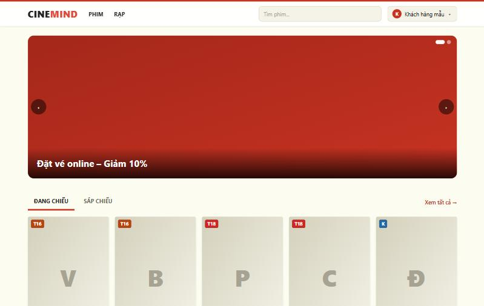
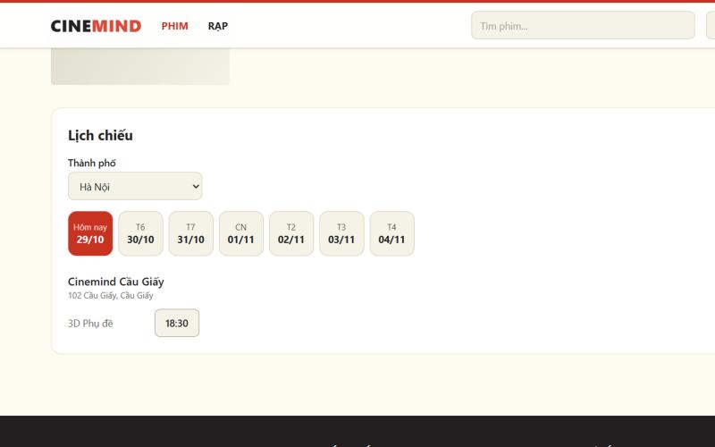
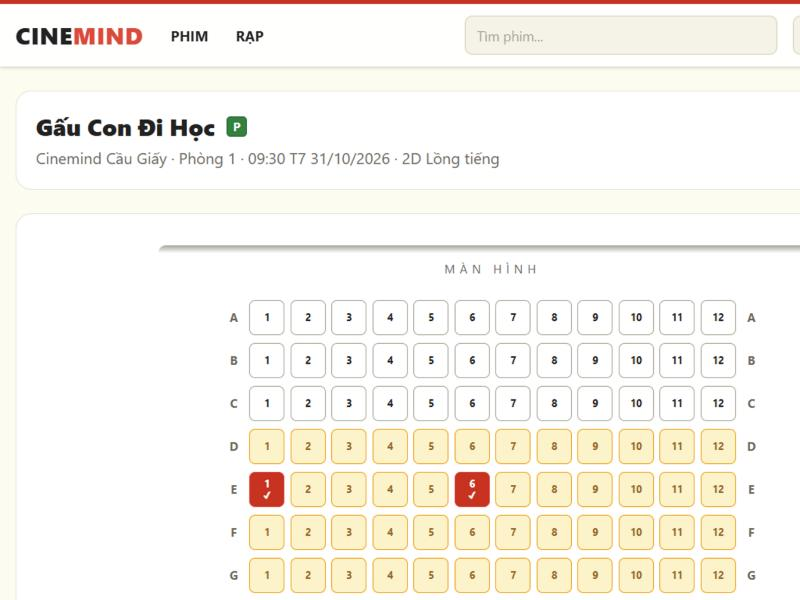
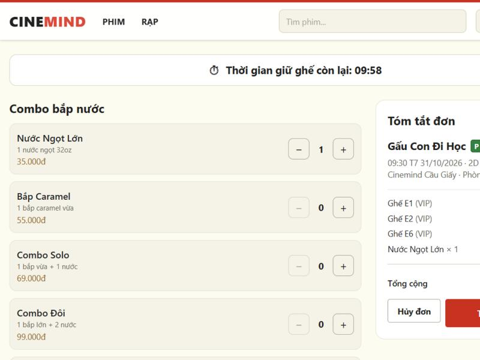
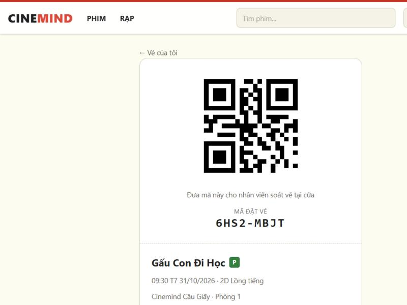
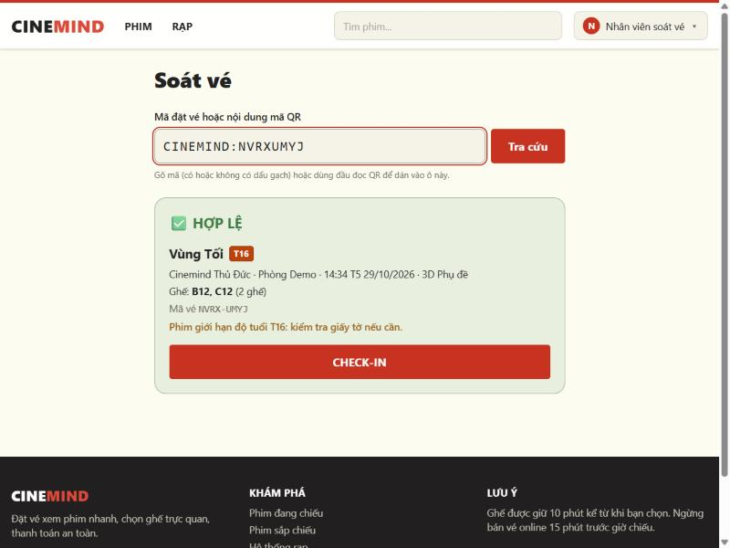
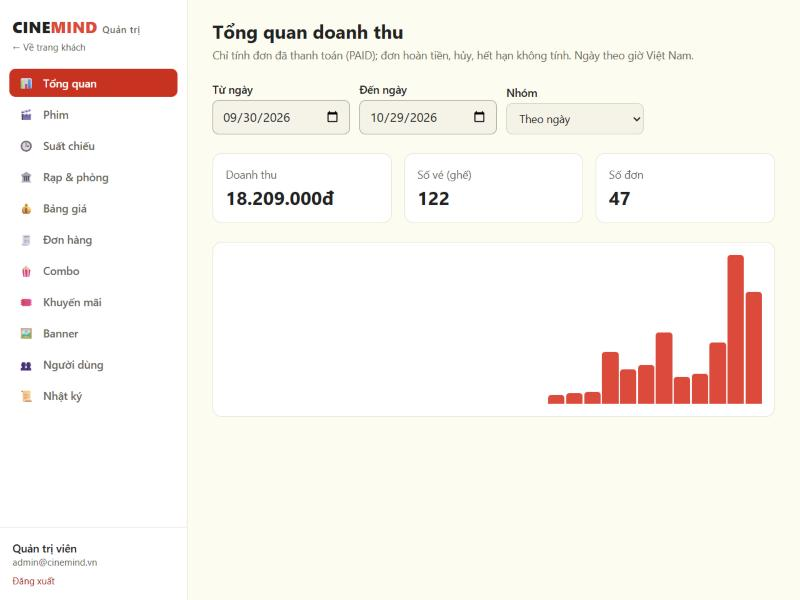
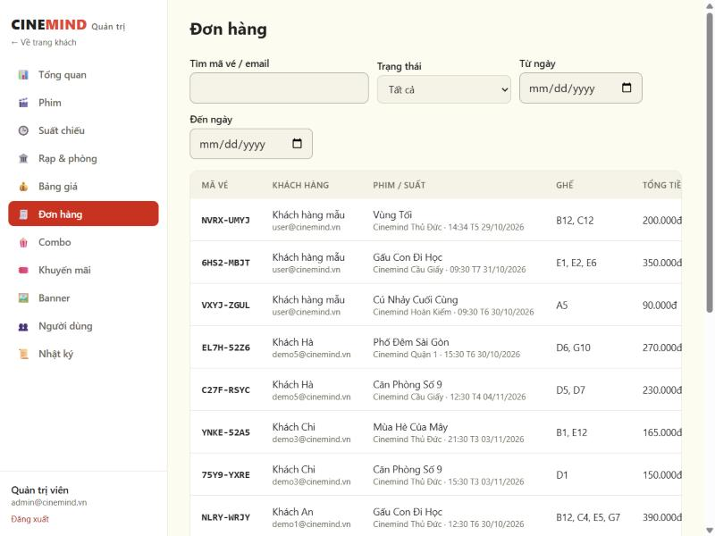

# 11 — Hướng dẫn sử dụng Cinemind

> Phiên bản: 1.0 — 29/10/2026 · Dành cho: **khách hàng**, **nhân viên soát vé**, **quản trị viên**.
> Ảnh chụp từ bản chạy thật với dữ liệu mẫu. Địa chỉ khi chạy trên máy: http://localhost:5173

---

## Phần A — Dành cho khách hàng

### A1. Xem phim và chọn suất chiếu

1. Ở **Trang chủ**, chọn tab **Đang chiếu** hoặc **Sắp chiếu**. Có thể tìm phim theo tên (không cần gõ dấu) ở ô tìm kiếm trên đầu trang.
2. Bấm vào một phim để xem mô tả, thời lượng, **phân loại độ tuổi** (P, K, T13, T16, T18) và lịch chiếu. Bấm **MUA VÉ** ở danh sách để vào thẳng trang phim.
3. Mục **Rạp** trên thanh menu liệt kê các rạp theo thành phố; bấm vào một rạp để xem lịch chiếu của rạp đó.

4. Trong khung **Lịch chiếu**: chọn **thành phố**, chọn **ngày** (7 ngày tới), rồi bấm vào **giờ chiếu**. Giờ hiển thị theo giờ Việt Nam. Giờ bị gạch ngang và mờ là suất **đã đóng bán** (còn dưới 15 phút hoặc đã chiếu).

> Bấm vào giờ chiếu khi chưa đăng nhập, hệ thống sẽ chuyển sang trang **Đăng nhập** rồi quay lại đúng suất bạn chọn. Chưa có tài khoản thì chọn **Đăng ký** (email, họ tên, mật khẩu từ 8 ký tự).

### A2. Chọn ghế

- **Trắng**: ghế thường · **Vàng**: ghế VIP · **Hồng**: ghế đôi (luôn chọn **cả cặp**).
- **Đỏ có dấu ✓**: ghế bạn đang chọn · **Sọc vàng**: ghế đang được người khác giữ · **Xám đặc**: ghế đã bán.
- Chọn tối đa **8 ghế** mỗi đơn. Sơ đồ tự cập nhật mỗi vài giây nên bạn thấy ngay khi ghế được giữ hoặc nhả.
- Cuối trang hiển thị **tạm tính**; số tiền chính thức do hệ thống tính ở bước sau.
- Bấm **Tiếp tục** để **giữ ghế**. Nếu có người vừa chọn trước bạn, hệ thống báo *"ghế vừa có người chọn"* và bỏ ghế đó khỏi lựa chọn, các ghế còn lại vẫn giữ nguyên để bạn chọn thay.

### A3. Combo, mã giảm giá và thanh toán

1. Ghế được giữ cho bạn **10 phút**; đồng hồ đếm ngược nằm ở đầu trang. Hết giờ, ghế tự được nhả và bạn quay lại chọn ghế.
2. Chọn **combo bắp nước** bằng nút **+ / −** (tối đa 10 phần mỗi loại).
3. Nhập **mã khuyến mãi** (nếu có) rồi bấm áp dụng. Nếu mã không dùng được, hệ thống nói rõ lý do (hết hạn, chưa đủ giá trị tối thiểu, đã dùng…).
4. Kiểm tra **Tóm tắt đơn** rồi bấm **Thanh toán**. Muốn bỏ đơn thì bấm **Hủy đơn** — ghế được nhả ngay.
5. Bạn được chuyển sang cổng thanh toán VNPay, rồi trở lại trang kết quả. Trang này tự kiểm tra trạng thái vài giây một lần, tối đa 30 giây. Nếu quá lâu vẫn chưa có xác nhận, bấm **Kiểm tra lại** hoặc xem **Vé của tôi** sau ít phút.

> Chỉ khi ngân hàng/VNPay xác nhận, đơn mới thành **Đã thanh toán**. Đóng trang ngay sau khi trả tiền cũng không sao — vé vẫn được ghi nhận.

### A4. Vé của tôi

- Vào menu tên bạn (góc phải) → **Vé của tôi** để xem các vé đã mua; bấm vào một vé để xem **mã QR** và **mã đặt vé** (ví dụ `6HS2-MBJT`).
- Khi đến rạp, **đưa mã QR (hoặc đọc mã đặt vé) cho nhân viên soát vé**. Một mã dùng cho cả đơn và chỉ vào được **một lần**.
- Vé chỉ soát được trong khoảng **30 phút trước đến 30 phút sau** giờ chiếu.
- Phim có giới hạn độ tuổi: nhân viên có thể kiểm tra giấy tờ tại cửa.
- **Hồ sơ cá nhân** (cũng trong menu) cho phép đổi họ tên, số điện thoại và mật khẩu.

> Vé đã thanh toán **không hủy / hoàn** được trên hệ thống. Nếu bị trừ tiền mà không có ghế (ví dụ ghế bị người khác lấy trước khi thanh toán được xác nhận), đơn chuyển sang **Chờ hoàn tiền** và rạp sẽ hoàn tiền thủ công.

---

## Phần B — Dành cho nhân viên soát vé

Đăng nhập bằng tài khoản nhân viên → menu tên → **Soát vé** (địa chỉ `/staff/check-in`).

1. Ô nhập đã được chọn sẵn. **Quét mã QR bằng máy đọc** (máy "gõ" nội dung rồi nhấn Enter) hoặc **gõ mã vé** (có hay không có dấu gạch, chữ hoa hay thường đều được).
2. Kết quả hiện ngay:
   - **✅ HỢP LỆ**: hiện phim, rạp, phòng, giờ chiếu, danh sách ghế và cảnh báo độ tuổi (nếu có). Bấm **CHECK-IN** để xác nhận cho khách vào.
   - **Từ chối** kèm lý do: chưa thanh toán · đã dùng (cho biết giờ đã quét) · quá sớm / quá muộn so với giờ chiếu · suất đã hủy · mã không tồn tại.
3. Mỗi vé chỉ check-in **một lần**. Nếu hai nhân viên quét cùng lúc, chỉ một người thành công.

---

## Phần C — Dành cho quản trị viên

Đăng nhập bằng tài khoản quản trị → menu tên → **Quản trị** (địa chỉ `/admin`). Thanh bên trái liệt kê các mục.

### C1. Tổng quan doanh thu

Chọn khoảng ngày và cách nhóm (**theo ngày / phim / rạp**). Báo cáo chỉ tính đơn **đã thanh toán**; đơn hoàn tiền, hủy, hết hạn không được tính. Ngày tính theo giờ Việt Nam.

### C2. Quản lý danh mục

| Mục | Làm được gì | Lưu ý |
|---|---|---|
| **Phim** | Thêm, sửa, đổi trạng thái (Sắp chiếu / Đang chiếu / Ngừng chiếu), xóa | Phim đã có suất chiếu **không xóa được** → chuyển sang "Ngừng chiếu". Ảnh nhập dạng đường dẫn `http(s)://`. |
| **Suất chiếu** | Thêm, sửa, hủy; lọc theo rạp, ngày | Nhập **giờ Việt Nam**. Hệ thống tự tính giờ kết thúc (thời lượng + 15 phút dọn phòng) và **chặn trùng giờ** trong cùng phòng. Để trống giá gốc = lấy theo Bảng giá. Suất đã có người đặt vé **không sửa / hủy được**. |
| **Rạp & phòng** | Thêm, sửa rạp; xem sơ đồ ghế từng phòng | Tắt rạp bị từ chối nếu còn suất sắp chiếu đã có người mua. Phòng và ghế do dữ liệu mẫu tạo. |
| **Bảng giá** | Giá gốc theo định dạng (2D / 3D / IMAX) × ngày thường / cuối tuần; phụ thu ghế VIP, ghế đôi | Phải điền đủ 6 giá và 3 phụ thu. Đổi giá chỉ áp cho suất tạo **sau đó**; đơn đã tạo giữ nguyên giá. |
| **Combo** | Thêm, sửa, ngừng bán, xóa | Combo đã nằm trong đơn không xóa được → bỏ chọn "Đang bán". |
| **Khuyến mãi** | Thêm, sửa, tắt, xóa mã | Giảm % (có mức giảm tối đa) hoặc số tiền cố định; có thời gian hiệu lực, giá trị đơn tối thiểu, giới hạn lượt. **Mã không đổi được** sau khi tạo. |
| **Banner** | Thêm, sửa, xóa ảnh trang chủ | Chỉ nhận URL `http(s)://` hoặc đường dẫn nội bộ. |

### C3. Đơn hàng và hoàn tiền

- Tìm theo **mã vé / email**, lọc theo **trạng thái** và **khoảng ngày**. Bấm **Xem** để thấy chi tiết ghế, combo, khách hàng và các giao dịch thanh toán.
- Đơn **Chờ hoàn tiền**: hoàn tiền cho khách qua cổng VNPay, **rồi** bấm **Ghi nhận đã hoàn tiền**. Hệ thống **không tự chuyển tiền**; nút này chỉ ghi nhận và không hoàn tác được. Nếu đơn đã được người khác xử lý, hệ thống báo cho bạn.

### C4. Người dùng

- Tìm theo email / họ tên, lọc theo vai trò (Khách hàng / Nhân viên / Quản trị viên).
- **Thêm nhân viên** (tạo tài khoản soát vé; nhớ nhắc nhân viên đổi mật khẩu).
- Đổi vai trò, **Khóa / Mở khóa** tài khoản — luôn có hộp xác nhận. Tài khoản bị khóa bị đăng xuất khỏi mọi thiết bị.
- Bạn **không thể khóa hoặc hạ quyền chính mình**, và hệ thống luôn giữ **ít nhất một** quản trị viên đang hoạt động.

### C5. Nhật ký thao tác

Mục **Nhật ký** cho biết **ai** đã làm **việc gì**, **lúc nào** (thêm / sửa / xóa, hoàn tiền, đổi vai trò, soát vé…). Có thể lọc theo loại đối tượng. Nhật ký **chỉ xem**, không sửa hay xóa được; mật khẩu và nội dung biểu mẫu **không** được lưu.

---

## Phần D — Câu hỏi thường gặp

| Câu hỏi | Trả lời |
|---|---|
| Tôi chọn ghế rồi mà báo ghế đã có người? | Có người vừa giữ trước bạn vài giây. Chọn ghế khác — những ghế còn lại của bạn vẫn được giữ. |
| Hết 10 phút giữ ghế thì sao? | Ghế tự nhả; bạn quay lại trang chọn ghế để chọn lại. |
| Bị trừ tiền nhưng chưa thấy vé? | Chờ vài phút rồi xem **Vé của tôi**. Nếu ghế đã bị người khác lấy, đơn chuyển sang "Chờ hoàn tiền" và rạp hoàn tiền thủ công. |
| Có đổi / hủy vé đã mua được không? | Không (theo quy định của hệ thống). |
| Sao không đặt được suất sắp chiếu? | Hệ thống ngừng bán online **15 phút** trước giờ chiếu. |
| Quên mật khẩu? | Chức năng quên mật khẩu qua email chưa có trong phiên bản này; liên hệ quản trị viên. |
| Admin: sao không xóa được phim / combo / mã? | Đã có suất chiếu hoặc đơn hàng tham chiếu. Dùng "Ngừng chiếu" / "Ngừng bán" / "Tắt" để ẩn khỏi khách. |

## Phần E — Cho người cài đặt

Xem `code/server/README.md` và `code/client/README.md` (cài đặt, tài khoản mẫu, lỗi thường gặp) và `docs/09-demo-script.md` (chuẩn bị dữ liệu demo).
